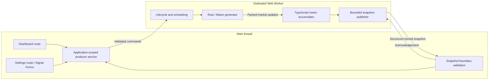

# Realtime market dashboard: high-level design

Snapshot transport was simplified on 2026-10-25: ordinary metric objects are
structured-cloned and validated once on receipt. Backpressure and lifecycle
guards are unchanged. Earlier milestone evidence describing buffer transfers
records the previous implementation; see [current validation evidence](production-validation.md#snapshot-transport-simplification).

Status: agreed technology choices; proposed architecture for implementation planning.

Date: 2026-10-25.

Requirements: [task-description.md](../task-description.md). That document remains the authoritative feature specification and must remain unchanged.

## 1. Purpose and scope

Build a modern, secure, responsive Angular application with a live market dashboard and producer settings. A Rust library compiled to WebAssembly generates simulated trades and book snapshots inside a dedicated Web Worker. TypeScript in the worker calculates cumulative metrics. Angular renders bounded snapshots rather than processing the event stream.

Version one includes the five required metrics, settings validation, pause/resume, run reset, producer status, meaningful failures, tests, and automatic deployment. It uses semantic HTML and SCSS. A backend, authentication, real market feeds, order execution, persistence, charts, and UI kits are outside this version. Future visual improvements can consume the same view models without changing the simulation pipeline.

## 2. Accepted technology decisions

| Concern           | Decision                                                                                             | Reason                                                            |
| ----------------- | ---------------------------------------------------------------------------------------------------- | ----------------------------------------------------------------- |
| Frontend          | Existing Angular and TypeScript versions; standalone lazy routes, zoneless change detection, signals | Fits the repository and keeps rendering explicit                  |
| Settings form     | Angular Signal Forms                                                                                 | User-selected signal-based form model and validation              |
| UI                | Semantic HTML and SCSS                                                                               | Small dependency footprint and accessible initial implementation  |
| Simulation        | Rust, wasm-bindgen, wasm-pack                                                                        | Typed numeric simulation, explicit ownership, native tests        |
| Execution         | One application-owned dedicated module worker                                                        | Keeps generation and aggregation away from the UI thread          |
| Aggregation       | TypeScript inside the worker                                                                         | Easy-to-review formulas and deterministic unit tests              |
| Numeric precision | Integer cents; bigint cumulative volume and notional                                                 | Exact cumulative arithmetic                                       |
| Transport         | Packed numeric Wasm batches; structured-cloned metric objects for Angular                            | Bounded traffic and one receiving validation pass                 |
| Scheduling        | Independent generation and snapshot publication                                                      | Every trade counts without requiring a render per batch           |
| Testing           | Rust unit tests, compiled-Wasm integration tests, Angular/worker tests                               | Covers algorithms, bindings, lifecycle, and UI behavior           |
| Deployment        | Cloudflare Pages with Git integration                                                                | Automatic builds and deployments with configurable static headers |

Signal Forms is an explicit user-authorized departure from the repository guide's default preference for typed reactive forms. Keep this choice local to the feature; do not silently replace it with reactive forms. Verify APIs against the installed Angular version during the initial integration milestone and document any version-specific limitations. The current Angular documentation describes model signals, schema validation, and field bindings through `@angular/forms/signals` [1].

Keep dependency versions exact, use the committed npm lockfile, and pin the Rust toolchain and Wasm build tools during implementation. Use Node 24.15+ within v24 and npm 11.12.1+ within v11 as required by the repository.

## 3. Architecture and ownership

| Component           | Owns                                                                               | Must not own                               |
| ------------------- | ---------------------------------------------------------------------------------- | ------------------------------------------ |
| Dashboard           | Presentation and user control interactions                                         | Timers, event aggregation, worker creation |
| Settings            | Editable draft, validation, submission feedback                                    | Active producer configuration before Apply |
| Application service | Single worker reference, accepted run ID, command correlation, readonly view state | Per-trade processing                       |
| Worker controller   | Active run, lifecycle, timers, Wasm instance, command ordering                     | DOM or Angular dependencies                |
| Rust generator      | Seeded PRNG and per-instrument evolving market state                               | Dashboard metrics or JavaScript randomness |
| Metric accumulator  | Per-instrument cumulative quantities and latest values                             | Complete event history                     |
| Snapshot publisher  | Publication cadence and bounded delivery                                           | Dropping trades before aggregation         |

Create the application service once at application scope and initialize it once regardless of the entry route. Route destruction must not terminate or recreate the worker. Destroying the application service terminates the worker and releases its listeners.

## 4. Simulation and data model

Each market update contains an instrument ID, price in cents, trade quantity, bid and ask in cents, and bid and ask quantities. Symbols are deterministic labels mapped from stable numeric IDs within a run.

The Rust generator maintains per-instrument price state and a deterministic, seedable PRNG. A run receives a seed; all subsequent random draws and price evolution execute in Wasm. Tests supply fixed seeds. Simulation randomness is not used for security purposes.

For each update, select an instrument, evolve its bounded positive price state, construct a positive spread, choose the trade price from that update's bid or ask, and generate positive trade quantity and nonnegative book quantities. Instruments may repeat within a batch. Zero book quantities are supported so the zero-denominator case remains meaningful.

Use explicit bounded unsigned integer fields and checked arithmetic. Choose and document concrete price, spread, and quantity bounds before implementation; the bounds must keep each generated value representable in the packed format. The generator validates instrument and batch counts even when callers have already validated them.

The batch boundary uses one flat numeric array with a documented, versioned record layout. One call returns exactly the requested number of records. Prefer wasm-bindgen-owned copied output initially; consume it immediately in the worker. Do not keep stale views into Wasm memory across calls that may grow memory. `wasm-pack build --target web` provides browser ES-module glue and explicit initialization [2].

Per-instrument aggregation retains only:

- Whether a trade/book snapshot has been received.
- Latest trade price, bid, ask, and book quantities.
- Cumulative trade quantity as `bigint`.
- Cumulative trade notional in cent-units as `bigint`.

Convert operands to `bigint` before multiplying price by quantity. Never perform a potentially unsafe `number` multiplication and then convert the result.

| Display metric | Source and calculation                                             | Initial or undefined state                                 |
| -------------- | ------------------------------------------------------------------ | ---------------------------------------------------------- |
| Last price     | Latest trade price in cents                                        | Unavailable before a trade                                 |
| Spread         | Latest ask cents minus bid cents                                   | Unavailable before a book snapshot                         |
| Volume         | Sum of trade quantities                                            | Zero                                                       |
| VWAP           | Exact cumulative notional / cumulative volume                      | Unavailable when volume is zero                            |
| Imbalance      | Latest `(bidQuantity - askQuantity) / (bidQuantity + askQuantity)` | Unavailable when no snapshot exists or denominator is zero |

Maintain VWAP as an exact rational value until presentation. A formatting utility performs integer quotient/remainder rounding to currency precision without converting unbounded totals to `number`. Use USD and two decimal currency places for version one, matching the requirements' examples. Round positive currency ties half-up. Display imbalance within [-1, +1], with two decimal places. Book quantities never contribute to trade volume.

## 5. Worker protocol and snapshot ownership

Use a versioned discriminated message protocol. Validate incoming values as `unknown` on both sides before narrowing. Check message kind, protocol version, identifiers, finite integers, ranges, payload lengths, row counts, and expected buffer layout.

| Direction      | Message                  | Purpose                                                          |
| -------------- | ------------------------ | ---------------------------------------------------------------- |
| Main to worker | Start/reset              | Apply validated settings and a new run ID                        |
| Main to worker | Pause / resume           | Change generation state for the current run                      |
| Main to worker | Snapshot acknowledgement | Release the current publication slot                             |
| Main to worker | Dispose                  | Best-effort orderly cleanup                                      |
| Worker to main | Ready                    | Wasm initialized successfully                                    |
| Worker to main | Command acknowledgement  | Confirm command ID, run ID, and resulting lifecycle state        |
| Worker to main | Snapshot                 | Publish cumulative values for a run and sequence                 |
| Worker to main | Error                    | Report a structured initialization, protocol, or runtime failure |

Every run-scoped message carries a run ID. Commands carry a monotonically increasing command ID; snapshots carry a monotonically increasing sequence within the run. Main-thread acceptance requires the current run ID and a newer snapshot sequence. A stale acknowledgement must not change the current control state.

There are two distinct data boundaries:

1. **Wasm to worker TypeScript:** packed generated updates remain inside one worker execution context. This is a Wasm binding/memory boundary, not a `postMessage` transfer.
2. **Worker to main thread:** publish a snapshot containing metadata and up to 50
   ordinary metric objects with bigint totals and exact VWAP pairs. Structured
   cloning provides independent receiver storage. The main-thread boundary
   validates once and constructs immutable rows for Angular.

No custom binary snapshot layout, transfer list, encoder, or decoder is needed.
Wasm linear memory remains entirely inside the worker. Publication still holds
one outstanding snapshot until its acknowledgement; slow receivers cannot build
an unbounded queue. Keep bigint values in structured-clone messages, not JSON.

Permit only one unacknowledged data snapshot. While it is outstanding, continue aggregating and mark the latest state as pending instead of queueing more snapshots. Acknowledgements identify both run and sequence. Reset clears the old publication slot; stale acknowledgements cannot release a new run's slot. The receiver acknowledges structurally valid stale snapshots even though it does not apply them.

## 6. Lifecycle and race handling

Expose initializing, running, paused, error, and disposed producer states. Represent a pending control command separately so the UI does not claim a transition before the worker confirms it.

### Startup

Create one worker, install handlers, and initialize Wasm. Show defaults with unavailable metrics and zero volume while loading. On readiness, start the default run: 5 instruments, 100 updates per batch, and a requested 500 ms interval. If the user applies settings during initialization, retain only the newest requested run and start it when ready.

### Apply

Validate the form and service input before changing the run. Allocate a new run ID, immediately invalidate old results, clear displayed metrics and totals, and send the settings to the worker. Even identical settings start a new run.

The worker cancels existing timers, releases the old generator, resets accumulators and publication state, constructs a fresh generator, and starts generation. Apply starts a running run even if the old run was paused. Associate asynchronous initialization completion with a generation token so an obsolete completion cannot start an earlier run.

### Pause and resume

Commands execute serially on the worker event loop. A synchronous batch already executing completes and is aggregated before Pause is handled. The worker then cancels generation, publishes the final cumulative state through the bounded publication path, and acknowledges Pause. Show a pending state until acknowledgement; the final snapshot may arrive afterward if another snapshot is outstanding.

While paused, do not mutate generator or accumulator state. Resume schedules the next batch relative to resume time, preserving values and PRNG state. Do not generate trades for the paused interval. Repeated Pause or Resume requests are idempotent for the same run; ignore commands targeting obsolete runs.

### Failures and disposal

Catch Wasm loading/instantiation errors, generator exceptions/traps, worker errors, and message deserialization failures. Cancel timers and enter an explicit error state. Preserve the last valid displayed snapshot for runtime failures, but mark it stale. An Apply that fails after clearing begins remains an empty failed new run; never resurrect old totals.

Offer a deliberate retry that creates a fresh run with the last requested valid settings. A fatal worker error requires terminating and replacing that worker before retry. Reset releases generator resources explicitly; application destruction terminates the worker even if a graceful Dispose acknowledgement is unavailable.

## 7. Scheduling and performance

The default nominal rate is 200 updates/second; the allowed maximum is 20,000 updates/second across all instruments. At most 50 rows are displayed.

Use a single non-overlapping generation timer and a monotonic clock. Schedule toward the next requested interval; if execution or browser throttling misses a deadline, schedule a future batch without replaying missed intervals. This avoids catch-up bursts. Background browser throttling can reduce achieved throughput; the requested cadence is not a real-time guarantee.

Publish normal data snapshots at most 20 times per second, with immediate leading publication when the slot and cadence allow. This refines the original 10 Hz proposal to support the low-latency goal; the [LLD](low-level-design.md) defines the scheduling details. Lifecycle acknowledgements are independent of this throttle, and reset/pause final state is published promptly when the snapshot slot is available. Rendering frequency does not affect accounting.

Keep retained market data O(instrument count + batch size), independent of event count. Exact bigint accumulators grow logarithmically in bit width as totals grow; there is no retained event history or unbounded message queue. Bound batch sizes and validate before allocation.

Use stable instrument identity in Angular `@for`, readonly signal state, and computed view derivations. Do not run expensive methods from templates or trigger updates per trade. A normal semantic table is sufficient for 50 rows. Measure UI responsiveness, batch duration, publication frequency, and memory behavior at maximum settings during implementation; add complexity only for observed problems. Wasm is required for simulation, but is not assumed to outperform JavaScript automatically.

## 8. Settings and presentation

| Setting                      | Default | Inclusive range |
| ---------------------------- | ------- | --------------- |
| Instrument count             | 5       | 1–50            |
| Updates per batch            | 100     | 1–1,000         |
| Batch interval, milliseconds | 500     | 50–2,000        |

All settings require finite integers. Reject empty input, fractions, nonnumeric values, and values outside the range. HTML input attributes improve interaction but do not replace runtime validation.

Signal Forms operates on a separate editable draft. Editing never changes the active producer. Apply snapshots the validated draft and invokes the application service. Returning to settings initializes the draft from active/requested valid settings; unsaved drafts may be discarded on navigation. Active settings and run state survive navigation, but neither persists across a reload.

Provide visible labels, field-level errors, keyboard-operable controls, focus indicators, table headers, and textual lifecycle status. Announce status/error changes accessibly without announcing every price update. Use an em dash for unavailable values and distinguish it from zero. Keep the layout usable on narrow screens through a contained horizontally scrollable table.

## 9. Security and deployment

Serve application code, worker code, and Wasm assets from the same origin over HTTPS. Validate protocol messages and settings at each execution boundary. Use Angular bindings rather than unsafe HTML APIs. No credentials, private account data, or security secrets belong in the frontend or Wasm artifact.

Configure a production CSP with narrowly scoped same-origin script, worker, and asset sources. Permit Wasm compilation with `wasm-unsafe-eval` where required, without general JavaScript `unsafe-eval` [4]. Verify Angular's generated scripts/styles and any style nonce/hash requirements against the actual production output rather than weakening CSP to make violations disappear. Worker responses need an appropriate CSP too; verify document and worker policies in the deployed build.

Configure suitable content-type, referrer, framing, and permissions headers through Cloudflare Pages `_headers` [5]. Serve `.wasm` with `application/wasm`. Test deep-link route fallback without rewriting missing worker/Wasm assets to HTML. Use content-hashed or versioned assets so deployments do not mix incompatible application, worker, and Wasm versions.

Cloudflare Pages Git integration builds on pushes, with the configured production branch publishing production and other configured branches publishing previews [6]. The build must compile Wasm from committed source, run required checks, and build Angular before publishing. A failed build must not publish a new deployment.

Commit Rust source, `Cargo.lock`, toolchain pins, npm lockfile, and reproducible build commands. Install Rust/build tools explicitly in the build workflow if absent from the host image; prove toolchain availability in the first deployment milestone. Keep any deployment credentials in provider-managed configuration, never browser assets. Provide README instructions and accessible repository/demo links at submission.

## 10. Validation strategy

| Layer                            | Required evidence                                                                                                                                                                                                        |
| -------------------------------- | ------------------------------------------------------------------------------------------------------------------------------------------------------------------------------------------------------------------------ |
| Rust unit tests                  | Exact requested batch sizes, deterministic seed behavior, state evolution, valid instrument IDs, positive prices/quantities, bid below ask, trade price equal to bid or ask, nonnegative book quantities, invalid inputs |
| Compiled-Wasm integration        | Actual compiled module initializes, real exports execute, packed layout decodes correctly, repeated calls retain state, reset/disposal work                                                                              |
| Metric unit tests                | Worked example ($102 last, 40 volume, $101.50 VWAP, $0.04 spread, 0.20 imbalance), repeated instruments, isolation, zero denominators, exact bigint totals beyond safe-number range, display-only rounding               |
| Worker lifecycle tests           | Defaults, Apply while running/paused/loading, repeated Apply, reset, pause/resume with fake clock, no catch-up, stale commands/results, acknowledgements, bounded publication, failures and cleanup                      |
| Angular tests                    | Signal Forms validation, draft isolation, Apply behavior, unavailable values, lifecycle feedback, navigation preserving the single producer, accessible control behavior                                                 |
| Browser integration smoke checks | Real worker and production Wasm loading, snapshot isolation, CSP, maximum settings, deep links, deployed asset paths                                                                                                     |

Use the repository's Vitest/jsdom and zoneless Angular testing conventions. jsdom does not establish real browser worker behavior; browser smoke checks are a separate integration activity. Formal end-to-end automation is not required. Use fake timers and deterministic seeds; avoid long real-time waits and chance-based assertions.

During implementation, extend validation to include Rust and compiled-Wasm checks while retaining existing strict type checks, lint rules, coverage thresholds, and production budgets. Run `npm run check` for application/tooling handoff and follow the repository validation skill. Do not weaken checks or exclude core worker logic to accommodate the feature.

## 11. Proposed implementation milestones

1. **Integration foundation:** pin Rust tooling; load a minimal real Rust/Wasm export inside an Angular module worker; prove production asset loading and Signal Forms compatibility. Establish the reproducible build command.
2. **Simulation engine:** implement stateful seeded generation and packed batches; complete native Rust and compiled-Wasm tests.
3. **Metrics and protocol:** implement bigint accumulation, formatting, protocol validation, snapshot boundary validation, and ownership tests.
4. **Lifecycle and scheduling:** implement the single service/worker, reset, pause/resume, run isolation, independent publication, and failure cleanup with deterministic tests.
5. **Application pages:** implement dashboard and Signal Forms settings with HTML/SCSS, accessibility, navigation persistence, and Angular tests.
6. **Quality and performance:** run full validation, inspect the production bundle, verify maximum settings and bounded queues, and resolve measured issues.
7. **Deployment and handoff:** configure Git-integrated Cloudflare builds, headers and routing, verify push-triggered deployment, document commands and architecture, and provide repository/demo links.

These are planning milestones, not authorization to implement, commit, push, or deploy in this documentation task. Each milestone should later be expanded into concrete tasks and acceptance criteria.

## 12. Assumptions and remaining implementation choices

No further product answer is required to begin detailed planning. Version one assumes USD, deterministic fictional symbols, no persistence, no catch-up after throttling, discarded unsaved settings drafts on route exit, and a 20 Hz maximum normal data publication rate. The [LLD](low-level-design.md) resolves the architecture into contracts, concrete defaults, and ordered implementation steps.

The initial technical milestone must settle exact Rust/tool versions, simulation bounds, the packed snapshot layout, production CSP details, and the compiled-Wasm test harness. These are implementation decisions to verify against the pinned repository and deployed build, not reasons to expand feature scope. The repository URL, Cloudflare project, and production branch will be selected when deployment is authorized.

## References

1. [Angular Signal Forms](https://angular.dev/guide/forms/signals/overview)
2. [wasm-pack build targets](https://rustwasm.github.io/docs/wasm-pack/commands/build.html)
3. [MDN: Transferable objects](https://developer.mozilla.org/en-US/docs/Web/API/Web_Workers_API/Transferable_objects)
4. [MDN: Content Security Policy](https://developer.mozilla.org/en-US/docs/Web/HTTP/Reference/Headers/Content-Security-Policy)
5. [Cloudflare Pages: headers](https://developers.cloudflare.com/pages/configuration/headers/)
6. [Cloudflare Pages: Git integration](https://developers.cloudflare.com/pages/get-started/git-integration/)
